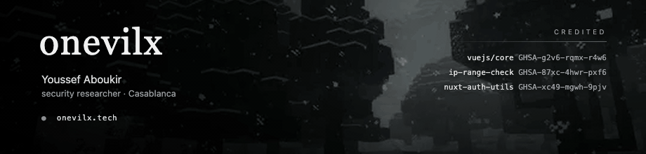

### Advisories

| | | |
|---|---|---|
| [`GHSA-g2v6-rqmx-r4w6`](https://github.com/vuejs/core/security/advisories/GHSA-g2v6-rqmx-r4w6) | `@vue/server-renderer` | SSR XSS via a carriage return in an attribute name &nbsp;·&nbsp; **High 7.2** |
| [`GHSA-87xc-4hwr-pxf6`](https://github.com/danielcompton/ip-range-check/security/advisories/GHSA-87xc-4hwr-pxf6) | `ip-range-check` | SSRF filter bypass with non-canonical IPv4 &nbsp;·&nbsp; **Moderate** |
| [`GHSA-xc49-mgwh-9pjv`](https://github.com/atinux/nuxt-auth-utils/security/advisories/GHSA-xc49-mgwh-9pjv) | `nuxt-auth-utils` | OAuth `state` unvalidated in 35 of 48 providers &nbsp;·&nbsp; **Moderate** |

### Write-ups

Whatever I'm allowed to publish, I publish — the advisories above, and the challenges I solve for the fun of it.

[Vue SSR XSS](https://www.onevilx.tech/posts/vue-ssr-xss-missing-cr/) &nbsp;·&nbsp;
[IPv4 SSRF bypass](https://www.onevilx.tech/posts/ip-range-check-ssrf-bypass/) &nbsp;·&nbsp;
[OAuth state](https://www.onevilx.tech/posts/nuxt-auth-utils-oauth-csrf/) &nbsp;·&nbsp;
[CORS on localhost](https://www.onevilx.tech/posts/cors-credentialed-localhost-reflection/) &nbsp;·&nbsp;
[Intigriti BRP](https://www.onevilx.tech/posts/intigriti-brp-dom-xss/) &nbsp;·&nbsp;
[coupon stacking](https://www.onevilx.tech/posts/intigriti-1026-coupon-stacking/) &nbsp;·&nbsp;
[base64 SQLi](https://www.onevilx.tech/posts/intigriti-0926-sqli-base64/)

### How I hunt

I go looking for the check that one endpoint forgot — broken access control, OAuth and session binding, parser differentials, DOM XSS, and the kind of logic that only breaks when you do things out of order.

Burp, Python and Playwright carry most of it. `ffuf`, `nuclei` and Semgrep when they earn their place. The rest is reading someone else's source code until a shortcut shows itself.

### Elsewhere

Studying software engineering at **1337 / 42 Network**, in Casablanca.
