<div align="center">



<a href="https://www.onevilx.tech"></a>
<a href="https://www.onevilx.tech/archive/"></a>
<a href="https://app.intigriti.com/profile/onevilx"></a>
<a href="https://github.com/onevilx?tab=repositories"></a>

</div>

---

## Three advisories, three small lessons

Every one is published, patched and credited. Click the ID — don't take my word for it.

**[`GHSA-g2v6-rqmx-r4w6`](https://github.com/vuejs/core/security/advisories/GHSA-g2v6-rqmx-r4w6)** · `@vue/server-renderer` · **High 7.2**<br>
A bare carriage return is whitespace to a validation regex and an attribute separator to a real HTML parser. One missing character in a character class turned `v-bind` object keys into a server-side XSS sink. The patch is one character long.

**[`GHSA-87xc-4hwr-pxf6`](https://github.com/danielcompton/ip-range-check/security/advisories/GHSA-87xc-4hwr-pxf6)** · `ip-range-check` · **Moderate**<br>
`127.1` is loopback. The parser said *unparseable*, the guard read that as *not private*, and the SSRF filter waved it through. Failing closed is a decision you have to actually make.

**[`GHSA-xc49-mgwh-9pjv`](https://github.com/atinux/nuxt-auth-utils/security/advisories/GHSA-xc49-mgwh-9pjv)** · `nuxt-auth-utils` · **Moderate**<br>
35 of 48 OAuth providers never compared the returned `state` to the stored one. The 13 that did are what proved it an oversight rather than a design choice — login CSRF across the rest.

---

<details>
<summary><b>Write-ups</b> — the full technical walkthrough for each, plus challenge solves</summary>

<br>

**Advisories**
- [Vue SSR XSS via a missing carriage-return check](https://www.onevilx.tech/posts/vue-ssr-xss-missing-cr/)
- [SSRF filter bypass with abbreviated IPv4](https://www.onevilx.tech/posts/ip-range-check-ssrf-bypass/)
- [OAuth `state` validation missing in nuxt-auth-utils](https://www.onevilx.tech/posts/nuxt-auth-utils-oauth-csrf/)
- [Weak OAuth state in hono-oauth-providers](https://www.onevilx.tech/posts/hono-oauth-providers-weak-state/)
- [Credentialed CORS reflection on localhost](https://www.onevilx.tech/posts/cors-credentialed-localhost-reflection/)

**Challenges**
- [Intigriti BRP — A 403 With Nothing In It](https://www.onevilx.tech/posts/intigriti-brp-dom-xss/) — a DOM-clobbering gadget that passes every check in the client source and still gets an empty 403, because the server enforces a rule the client never applies
- [Intigriti 1026 — coupon stacking](https://www.onevilx.tech/posts/intigriti-1026-coupon-stacking/)
- [Intigriti 0926 — base64 SQLi](https://www.onevilx.tech/posts/intigriti-0926-sqli-base64/)

</details>

---

## What I go looking for

```text
authorization    broken object/tenant boundaries, role confusion, the 10th endpoint
                 that forgot the check the other 9 remembered
identity         OAuth state and PKCE binding, session fixation, reset-token scoping
parsers          validate-here / use-there differentials — regex vs spec, client vs server
client-side      DOM clobbering, postMessage, sanitizer bypasses, gadget hunting
logic            races, ordering, negative quantities, anything priced in a request body
```

Burp, Python, Playwright, `ffuf`, `nuclei`, Semgrep — and mostly just reading other people's source code until the shortcut shows up.

Software engineering at **1337 / 42 Network**. Morocco.

---

<div align="center">
<sub>Private-program findings stay private. Everything linked here is public, disclosed, or mine.</sub>
</div>
